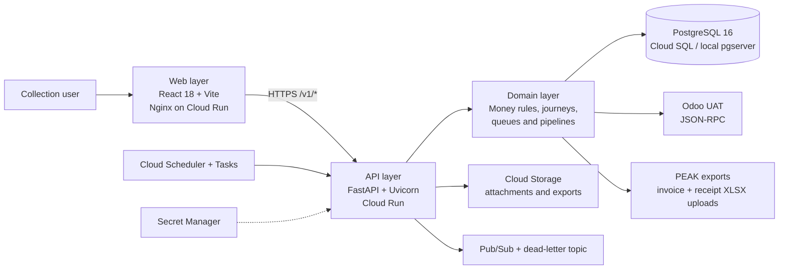
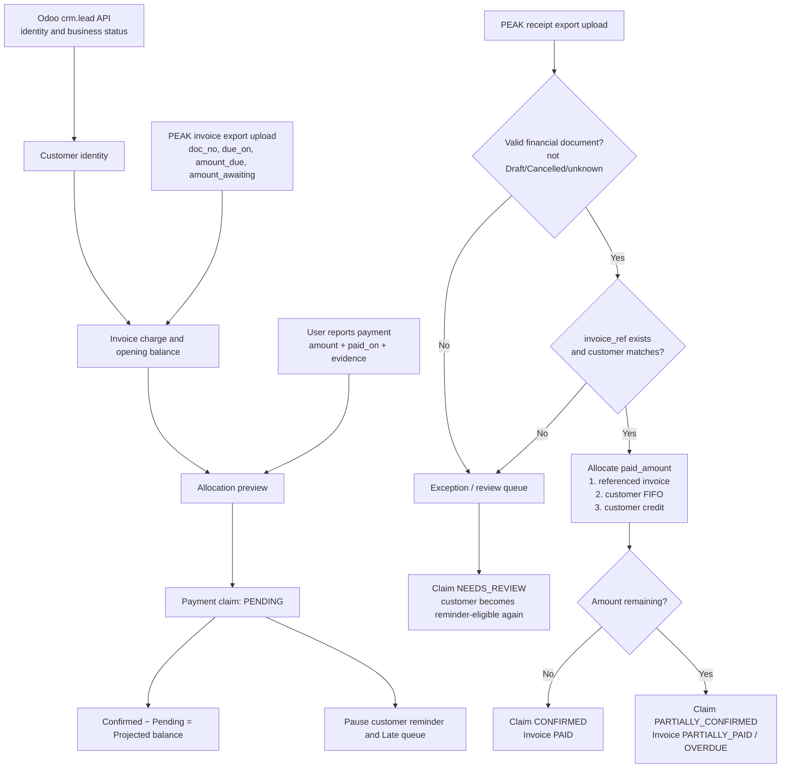

# Volt Debt

Volt Debt is a working debt-collection console prototype for Volt's EPC and SPV
books. It gives collection officers one place to review accounts, plan daily work,
record contacts and promises to pay, monitor payment positions, manage NPL/recovery
work, and audit operational decisions.

> This repository is a prototype, not a production collection system. It is designed
> to make business rules visible and testable before they become part of an MVP.

## Objectives

- Make collection rules and unresolved business decisions explicit.
- Keep money calculations in the backend, where they can be tested and audited.
- Provide Thai and English operational screens for officers and reviewers.
- Support fixture-based development, controlled Odoo UAT reads and reviewed PEAK
  invoice/receipt export uploads.
- Preserve traceability through request identity, role checks, and append-only audit
  records.
- Keep credentials, customer exports, generated passwords, and runtime data out of
  source control.

## System architecture



The application is a layered monolith with separate web and API containers. In local
development, Vite serves the browser app and proxies `/api` to FastAPI. The backend can
also serve a staged frontend bundle from `backend/static/` when the deployment script
copies one into the image.

### Request and data flow

1. A browser loads the React single-page application.
2. The frontend calls the FastAPI `/v1/*` endpoints.
3. Authentication and audit middleware resolve the user, role, session, and request ID.
4. Routers validate the HTTP request and call domain modules.
5. Domain modules calculate DPD, arrears, allocation, payment position, collection
   priority, and recovery state using `Decimal`-based money logic.
6. Repositories and pipeline modules read or write PostgreSQL, read customer identity
   from Odoo when configured, and process applied PEAK invoice/receipt export files.
7. Responses return data or RFC 9457-style problem details. The frontend renders the
   result but does not recalculate money.

## Service issue instalment deferrals

On the customer overview, **เลื่อนงวดเพราะปัญหาบริการ** lets a collection officer
select unpaid overdue cycles, record the unavailable service period and confirmed
ticket or confirmation note, preview the new dates and balances, then confirm.
A PEAK receipt is not required. The original cycles move to the contract tail;
cycle count, face amounts and actual received cash are preserved. Collection DPD,
penalty, NPL assessment and follow-up tasks use the adjusted dates. PEAK invoice
balances remain visible separately, with a pending accounting review.

Each record retains actor, evidence, original/new dates, accounting references and
reversal history. Reversal requires a fresh preview and refuses cycles with received
or pending payments. A linked service ticket stays open; its original whole-contract
hold is scoped to the adjusted cycles so other overdue cycles remain actionable.

The API lives at `/v1/contracts/{uid}/service-deferrals` with `/preview`,
`/{record}/reverse-preview`, `/{record}/reverse` and `/{record}/accounting-review`.
`GET /v1/service-deferrals?accounting_status=PENDING_REVIEW` lists accounting tasks.
Debt roles can confirm/reverse; OPS can also record accounting reviews. No endpoint
writes PEAK documents. Confirmation requires the preview version and an idempotency
key; changed payment or schedule inputs require another preview.

The repeatable migration creates `records.service_deferral` in PostgreSQL. Local
development without `DATABASE_URL` uses `backend/var/service-deferrals.sqlite3`;
`VOLT_SERVICE_DEFERRALS_PATH` can select another local file. The local file is shared
across browser sessions and survives restarts; production always uses PostgreSQL.

## Amount-led payment status journey

The implemented payment journey treats money as the source of financial status. A
user no longer marks a customer paid from a status selector on the case screen.
Instead, an authenticated collection user records the amount received as a provisional
claim. An applied PEAK receipt export confirms the cash and allocates it to invoices.

This journey deliberately includes only:

- Odoo `crm.lead` API data for customer identity and business status.
- PEAK invoice export uploads for invoice charges and opening balances.
- PEAK receipt export uploads for confirmed cash events.

It does **not** call the PEAK API. Splitting an invoice payment into principal,
interest and fee components remains outside this journey under decision `OD-02`.

### Previous and current journey

| Concern | Previous journey | Current amount-led journey |
|---|---|---|
| Manual payment | A Manager selected a customer-level `payment_status` directly | An OFFICER, SUPERVISOR, MANAGER or OWNER records amount, payment date and optional evidence as a `PENDING` claim |
| Financial decision | Primarily followed PEAK invoice status and `amount_awaiting` | Derives invoice status from charge, confirmed allocations and provisional allocations |
| Partial payment | Reduced only the invoice named by a receipt | Keeps the invoice `PARTIALLY_PAID` and shows its remaining amount |
| Overpayment | Did not carry money across invoices | Closes the referenced invoice, applies the rest FIFO, then stores any remainder as customer credit |
| Repeated receipt exports | Could depend on the most recently applied run | Combines every applied run and keeps the latest observation for each receipt number |
| Reminder | Could be created per invoice | Builds one consolidated reminder per customer per Bangkok calendar month |
| Audit | Primarily recorded a status change | Records Claim → Match → Allocation → balance before/after, including reversal and exceptions |

### End-to-end flow



### Source fields and mapping

| Source | Fields used | Meaning in this journey |
|---|---|---|
| Odoo `crm.lead` | `volt_id`, `phone`, `mobile`, `contact_name`, `stage_name`, `com_status` | Identifies the customer and carries business workflow state; never proves that money was received |
| PEAK invoice export | `doc_no`, `contact_code`, `reference`, `issued_on`, `due_on`, `cycle`, `amount_due`, `amount_total`, `amount_awaiting` | `doc_no` is the invoice key; amounts and dates form the invoice balance and FIFO order |
| PEAK receipt export | `doc_no`, `invoice_ref`, `contact_code`, `paid_on`, `paid_amount`, `status` | `doc_no` is the immutable cash-event key; `paid_amount` changes balances; `status` only excludes Draft, Cancelled and unknown documents |
| Manual payment claim | `customer_uid`, `amount`, `paid_on`, `evidence_uid`, `note`, `created_by`, `idempotency_key` | Creates a provisional allocation without changing the confirmed ledger |

Customer matching is evaluated in this order:

1. Active manual identity link.
2. Eleven-digit PEAK `contact_code` equal to `customer_no`.
3. Exact V-ID.
4. PEAK V-ID → Odoo phone → customer phone.
5. Composite code/name matches remain candidates and require review.

A receipt auto-confirms only when its `invoice_ref` resolves to an invoice in the
applied invoice data **and** the receipt customer is the same customer as that
invoice. Matching only one side creates a reconciliation exception.

### Amount and status rules

- Initial invoice bootstrap uses `opening_paid = amount_due - amount_awaiting`.
- Receipt allocation uses `paid_amount`, never a PEAK paid/overdue status label.
- Allocation order is the referenced invoice first, then the same customer's other
  invoices by `due_on`, `issued_on`, and `doc_no`; excess becomes customer credit.
- `confirmed_outstanding = amount_due - confirmed allocations`.
- `projected_outstanding = max(0, confirmed_outstanding - pending allocations)`.
- An invoice is `PAID` when confirmed outstanding is zero, `PARTIALLY_PAID` when
  confirmed cash exists but a balance remains, and `OVERDUE` when a balance remains
  after its due date.
- While any active claim exists, the case response shows `payment_status = PENDING`
  and preserves the ledger-derived answer in `payment_status_confirmed`.
- Claims are refused for `NPL`, `CLOSED`, `TERMINATED` and `NOT_INSTALLED` cases.

### Import and reconciliation semantics

- Applying the same receipt file again does not duplicate cash: observations are
  deduplicated by receipt `doc_no` across all applied runs.
- A later `CANCELLED` observation deactivates and reverses the previous allocation
  without deleting its audit history.
- Unknown receipt status, missing invoice reference, missing invoice and customer
  mismatch are not guessed; they remain in the reconciliation exception queue.
- The filename parser keeps `covers_from`, `covers_to` and the real export timestamp
  separate. For example, `...20260901_20260930_20260914_114532.xlsx` was exported at
  `2026-09-14 11:45:32`; `2026-09-30` is only the selected coverage end.
- A pending claim whose payment date is covered by an applied receipt report but has
  no strict match becomes `NEEDS_REVIEW`. It leaves the Pending queue and becomes
  eligible for collection/reminder work again.

### User-facing journey and API

The customer case action is **Report payment / แจ้งรับชำระ**:

1. Enter amount and payment date, with optional invoice reference, note and evidence.
2. Preview invoice allocations, balance before/after and possible customer credit.
3. Save the claim; the case displays “paid — awaiting PEAK confirmation”, while the
   confirmed status and confirmed balance remain visible.
4. Apply a PEAK receipt export. The result reports confirmed claims, partial claims,
   claims needing review, invoice allocation and remaining customer credit.
5. Inspect each invoice's confirmed paid, pending amount, confirmed/projected
   outstanding and receipt references.

| Endpoint | Purpose |
|---|---|
| `POST /v1/customers/{uid}/payment-claims:preview` | Preview reference-first/FIFO allocation without writing confirmed money |
| `POST /v1/customers/{uid}/payment-claims` | Save an idempotent provisional claim |
| `GET /v1/customers/{uid}/payment-claims` | Read the customer's claim history and targets |
| `POST /v1/payment-claims/{uid}:cancel` | Cancel an unconfirmed claim as its creator or a Manager/Owner |
| `GET /v1/payment-reconciliation/exceptions` | Read active claim and receipt matching exceptions |
| `GET /v1/customers/{uid}/payment-reminders:preview` | Build one consolidated monthly reminder payload |
| `POST /v1/customers/{uid}/payment-reminders` | Record the monthly send guard and audit event |

The reminder payload combines every outstanding invoice for the customer. An active
Pending claim pauses reminders for the whole customer, and `(customer_uid, YYYY-MM)`
prevents a second send in the same month.

## Technology stack by layer

| Layer | Technologies | Responsibility |
|---|---|---|
| Web UI | React 18, React Router 6, Vite 5, JavaScript, CSS design tokens | Screens, navigation, forms, tables, boards, Thai/English presentation |
| Frontend testing | Vitest, Testing Library, jsdom, Puppeteer Core | Component, interaction, accessibility-adjacent, and browser-flow verification |
| API | Python 3.12, FastAPI, Starlette, Uvicorn, Pydantic | HTTP routes, validation, middleware, error responses, health endpoints |
| Domain | Python modules, dataclasses, `Decimal` | Collection rules, DPD, arrears, penalties, schedules, allocations, journey and recovery state |
| Data access | SQLAlchemy 2, psycopg 3, SQL migrations | PostgreSQL connections, landing tables, session state, audit records, data mapping |
| Database | PostgreSQL 16 / Cloud SQL | Operational state, imported source data, audit trail, integration runs |
| Integrations | Odoo JSON-RPC, PEAK invoice/receipt XLSX uploads | Customer identity intake, invoice matching, receipt reconciliation and payment confirmation; the payment journey does not call the PEAK API |
| Files and security | Cloud Storage, attachment guards, ClamAV service boundary, Secret Manager | Upload validation, document storage, malware scanning, secret delivery |
| Async operations | Cloud Scheduler, Cloud Tasks, Pub/Sub | Scheduled reconciliation, background work, domain-event delivery and retries |
| Infrastructure | Docker, Nginx, Terraform, Cloud Build, Cloud Run, VPC, Cloud NAT, Cloud Armor | Build, deploy, networking, runtime isolation, scaling and security controls |
| Quality | pytest, Vitest, black-box checks, production builds | API/domain tests, UI tests, end-to-end contract checks and bundle validation |

## Repository structure

```text
volt-debt-prototype/
├── backend/                 FastAPI application and backend tests
│   ├── app/                 API, domain, persistence and integration code
│   ├── tests/               pytest unit, API, database and regression tests
│   ├── Dockerfile           Python 3.12 / Uvicorn production image
│   ├── requirements.txt     Python dependencies
│   ├── pytest.ini           pytest configuration
│   └── .env.example         variable names only; copy locally and add values
├── frontend/                React single-page application
│   ├── src/                 screens, components, libraries, styles and tests
│   ├── public/              public static files
│   ├── Dockerfile           Vite build followed by Nginx runtime image
│   ├── nginx.conf           SPA routing, caching and security headers
│   ├── vite.config.js       local proxy, build and test configuration
│   └── package.json         frontend scripts and dependencies
├── infra/                   Google Cloud infrastructure as code
│   ├── terraform/           Cloud Run, Cloud SQL, IAM, VPC, Pub/Sub and secrets
│   └── cloudbuild.yaml      test, image build, migration and deploy pipeline
├── scripts/                 local run, verification, import and deployment tools
├── docs/                    product, design, architecture, guides and history
├── skills-lock.json         pinned repository skill metadata
├── .gitignore               dependency, runtime, secret and private-data exclusions
└── README.md                project entry point
```

### `backend/app/`

| Path | Purpose |
|---|---|
| `main.py` | Creates the FastAPI app, middleware chain, router registration, health checks and optional static serving |
| `routers/` | HTTP boundary grouped by feature: login, today, payments, reports, settings, imports, pipelines and audit |
| `money/` | Pure money rules: allocation, arrears, DPD, fee states, penalties, schedules and band sets |
| `pipelines/` | Import and write workflows for Odoo, sheets and PEAK; matching, conflicts, receipts and run state |
| `integrations/` | External-system adapters for Odoo and PEAK |
| `attachments/` | File guard, scanner abstraction and attachment storage |
| `collections/` | Daily-contact rules and collection-specific state |
| `jobs/` | Batch and scheduled job entry points |
| `auth.py`, `user_accounts.py`, `session.py` | Authentication configuration, user records and session isolation |
| `audit.py`, `audit_store.py` | Audit enrichment and append-only persistence |
| `db.py`, `schema.sql`, `migrate.py` | Database connection, schema definition and idempotent migration |
| `book.py`, `book_source.py`, `landing.py` | Served book construction and imported-data landing layer |
| `journey.py`, `ladder.py`, `board.py`, `cases.py` | Collection journey, contractual ladder, work boards and case state |
| `fixtures.py` | Hand-authored fictional scenarios used for demos and tests |
| `fixtures_orders.json` | Generated synthetic order and loan-book records; contains no customer identities |
| `fixtures_sheet.json` | De-identified synthetic sheet scenarios; exported identities are not committed |
| `config.py`, `errors.py`, `clock.py` | Governed settings, problem responses and business-time handling |

### `frontend/src/`

| Path | Purpose |
|---|---|
| `main.jsx`, `App.jsx` | Browser entry point, application shell and route composition |
| `screens/` | Top-level product views such as Today, Calendar, Book, Payments, Recovery, Reports and Settings |
| `components/` | Reusable boards, tables, drawers, dialogs, navigation, status and import components |
| `components/import/` | Shared import-workflow UI parts |
| `components/npl/` | NPL and recovery-specific UI components |
| `lib/api.js` | API client boundary |
| `lib/i18n/` | Thai and English dictionaries |
| `lib/` | Identity, preferences, events, formatting, navigation and data-epoch helpers |
| `styles/` | Design tokens and feature-level stylesheets |
| `assets/` | Versioned application images |
| `*.test.jsx`, `*.test.js` | Tests colocated with the behavior they protect |

### `infra/terraform/`

| File | Purpose |
|---|---|
| `cloud_run.tf` | API, web and malware-scanner Cloud Run services |
| `cloud_sql.tf` | Private PostgreSQL 16 Cloud SQL instance and backups |
| `network.tf` | VPC, private service access, serverless connector, static NAT and Cloud Armor |
| `iam.tf` | Service accounts, roles and Cloud Run invocation policy |
| `secrets.tf` | Secret Manager resources and runtime secret bindings |
| `storage.tf` | Document and export buckets |
| `pubsub.tf` | Domain-event topics, push subscriptions and dead-letter handling |
| `scheduler.tf` | Scheduled jobs and Cloud Tasks queues |
| `variables.tf`, `versions.tf` | Environment inputs and provider constraints |

### `scripts/`

| Path | Purpose |
|---|---|
| `run_prototype.sh` | Starts the local API and Vite UI |
| `verify_all.sh` | Runs backend tests, frontend tests, production build and black-box checks |
| `pg_local.sh` | Manages the repository-local PostgreSQL server |
| `deploy_gcp.sh`, `provision_stg.sh` | GCP deployment and staging provisioning |
| `import_master_sheet.py`, `import_order_master.py` | Convert authorised local exports into runtime data; outputs must be reviewed before use |
| `pull_odoo_csv.py`, `compare_crm_to_sheet.py` | Local Odoo extraction and reconciliation tools |
| `probe_rebuild.mjs`, `uat_*.mjs`, `e2e_check.py` | Browser probes, UAT automation and API contract checks |
| `guides/` | Generates tester documentation; password-bearing output stays outside Git |

### `docs/`

`docs/README.md` is the detailed documentation index. The main levels are:

- `product/`: requirements, journeys and workflow references.
- `design/`: design system, UI sources and handoff material. Local UAT captures are
  intentionally excluded because screenshots can contain customer data.
- `planning/`: active implementation plans.
- `guides/`: tester and staging instructions.
- `assets/`: architecture, data-flow and operating-procedure diagrams.
- `odoo-comparison/`: rules reference consumed by the Odoo pipeline.
- `staging-guide/`: source for the generated staging guide.
- `archive/`: superseded plans and briefs kept for traceability.

## Local development

### Prerequisites

- Python 3.10 or newer; deployment uses Python 3.12.
- Node.js 20 or newer; the frontend image uses Node.js 22.
- npm.
- macOS for the bundled `pgserver` local PostgreSQL workflow, or another reachable
  PostgreSQL 16 instance.

### Install dependencies

```bash
python3 -m venv backend/.venv
backend/.venv/bin/pip install -r backend/requirements.txt

cd frontend
npm ci
cd ..
```

### Configure optional integrations

```bash
cp backend/.env.example backend/.env
```

Only add authorised local Odoo UAT credentials to `backend/.env`. PEAK payment
reconciliation uses uploaded export files and needs no PEAK API credential. The file
is ignored by Git. Runtime mode variables such as `DATABASE_URL` and `AUTH_MODE`
should be passed by the shell or the deployment platform rather than saved in that
file.

### Run the application

```bash
./scripts/run_prototype.sh
```

Default local endpoints:

- Web: `http://localhost:5173`
- API: `http://127.0.0.1:8000`
- Health: `http://127.0.0.1:8000/healthz`

The default script starts local PostgreSQL and enables the authenticated CRM-lead demo.
Without authorised external credentials, run the API and frontend separately against
the repository's fictional scenario data.

## Verification

Run the complete local gate:

```bash
./scripts/verify_all.sh
```

Or run individual layers:

```bash
cd backend && .venv/bin/python -m pytest tests/
cd frontend && npm test
cd frontend && npm run build
```

## Deployment

- Terraform under `infra/terraform/` describes the target GCP topology.
- `infra/cloudbuild.yaml` runs backend tests, builds container images, executes the
  migration job, and deploys a candidate API revision.
- `scripts/deploy_gcp.sh` stages generated build inputs and drives the deployment.
- Secrets are references to Secret Manager resources; secret values do not belong in
  Terraform variables, shell history, Docker images, or this repository.

Treat the infrastructure as a reviewed deployment definition, not proof that every
resource has already been applied in every environment.

## Sensitive-data policy

Do not commit:

- `.env` files or live service credentials.
- raw customer/account exports or unsanitized importer outputs.
- raw Odoo pulls under `data/odoo/`.
- generated tester guides containing passwords under `build/`.
- PEAK PDF/XLSX exports containing citizen IDs or addresses.
- review packages, feedback documents, screenshots, and UAT evidence captures.
- private keys, service-account JSON files, database dumps, logs, or runtime caches.

Before pushing, verify the tree:

```bash
git status --ignored --short
git grep -Il -E 'BEGIN .*PRIVATE KEY|github_pat_|ghp_|AKIA[0-9A-Z]{16}' HEAD -- .
```

The committed `fixtures_orders.json` and `fixtures_sheet.json` contain fictional,
de-identified demo identities. Private source exports belong only in ignored runtime
locations such as `backend/var/` or `data/odoo/`.

## Project status

This codebase is a working prototype with a broad automated test suite and drafted GCP
infrastructure. It should be used for rule validation, UAT and architecture discussion;
production readiness still requires a formal security review, privacy review, operating
model, observability baseline, disaster-recovery exercise and approval of the remaining
business decisions.
