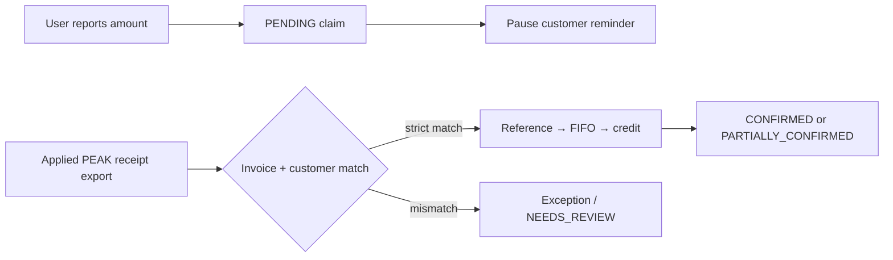

# Documentation index

Every document in this repo lives under `docs/`, sorted by purpose. Code, infra, and
run scripts stay at the root (`backend/`, `frontend/`, `infra/`, `scripts/`); runtime
pulls live in `data/` (gitignored). See the root
[README repository map](../README.md#repository-structure) for the complete layout.

## Current payment-status journey

The implemented payment-status journey is **amount-led**:

Odoo provides customer identity and business status. PEAK invoice exports provide
invoice charges/opening balances, and PEAK receipt exports provide confirmed cash.
The journey does not use the PEAK API and does not set financial status directly from
a source status field. The complete flow, field mapping, allocation rules, import
semantics and API surface are documented in the root
[README — Amount-led payment status journey](../README.md#amount-led-payment-status-journey).

| Folder | Holds | Status |
|---|---|---|
| `product/` | What the system must do: the 2026-09-02 realignment set (v2.6, Workflow Alignment v3.0, Interview and SOP Findings), the deck (`workflow-v20-epc-spv.md`), the broader journey (`user-journey.md`), the rebuild deltas (`spec-deltas-v25-rebuild.md`); the implemented amount-led payment journey is kept current in the root README | Active — the authority ladder |
| `planning/` | `00-FINAL-PLAN.md`, the current build round | Active |
| `design/` | How it looks and was built: `final-ui/` (the design source), `handoff-v2/`, `rebuild-2026-09/` (plan record + evidence), `design-system.md`, `er-diagram.html`, `import-data-flow.md` / `.html` | Active |
| `guides/` | Tester-facing guides: `staging-user-testing.md`, `login-on-for-a-demo.md`, `login-tester-guide.docx` | Active |
| `assets/` | Diagram sets — `SOP/`, `HLD/`, `GCP design/`, `Staging diagram/`, `Odoo dataflow/`, `dashboard-input/`, `integration-flow/`, `PEAK export/` — each with its generator `src/` and README | Active |
| `odoo-comparison/` | The business-rules reference the API parses: `odoo_compare.md` | Active — path fixed |
| `staging-guide/` | The Netlify guidebook source: `index.template.html`, `netlify.toml`, `_headers` | Active — path fixed |
| `archive/briefs/` | Superseded briefs kept as records: `figma-0*.md`, `spec-api-and-board.md`, `spec-money-engine.md`, `spec-deltas-v21-v24.md`, `screens-v2/` | Superseded |
| `archive/superpowers/` | The development plans and specs that produced the current build (2026-09-09 → 2026-09-15) | Closed record |

## Paths code reads and writes — do not move

| Path | Used by |
|---|---|
| `docs/odoo-comparison/odoo_compare.md` | `backend/app/pipelines/rules.py` (business rules reference file, staged by `scripts/deploy_gcp.sh`) |
| `docs/staging-guide/` | `scripts/build_staging_guide.py` → `build/staging-guide/` → Netlify `volt-debt-uat-guide` |
| `docs/design/rebuild-2026-09/evidence/` | Written by `scripts/probe_rebuild.mjs` |
| `docs/guides/` | Default output of `scripts/guides/build_login_guide.py` |

## Archive rule

`archive/` is read-only history: links inside archived files may point at paths as
they stood when written. Active documents (`product/`, `design/`, `planning/`,
`guides/`, `assets/`, and the two fixed paths above) must reference current paths.
