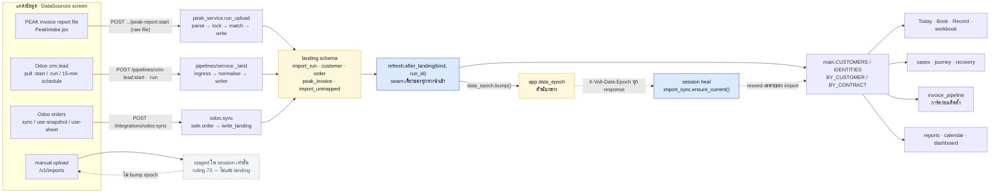
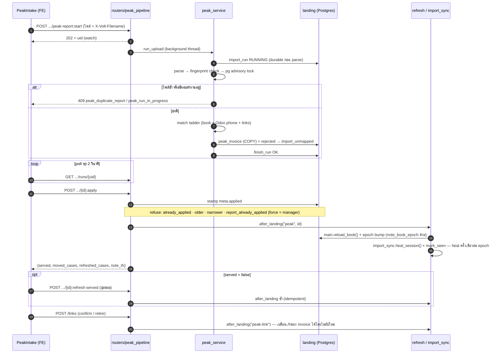
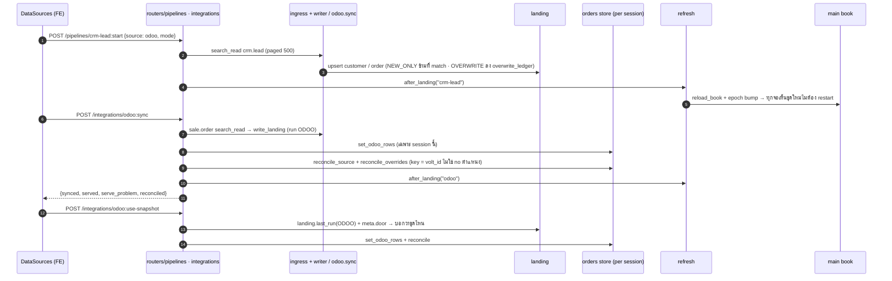
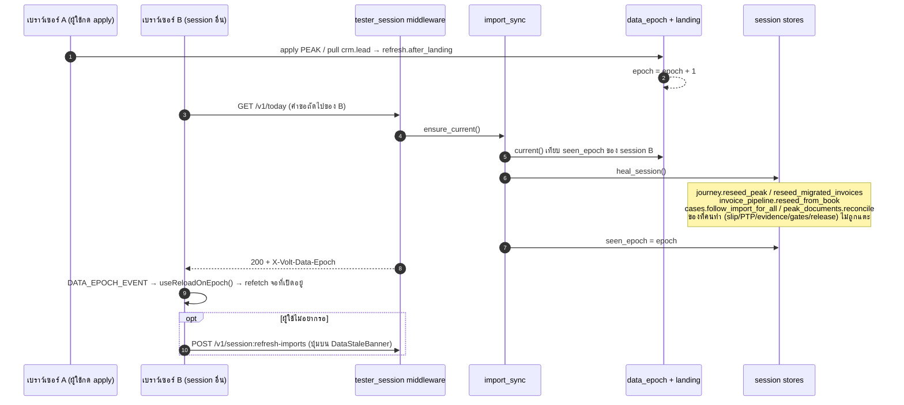

# Import Data — Data Flow Diagrams

> Source of truth for how imported data reaches every feature, after the sync work of
> 2026-09-20 (`app/refresh.py`, `app/import_sync.py`, `app/data_epoch.py`,
> `landing.import_unmapped`). Companion viewer: `docs/import-data-flow.html`.

## 1 — Overview: sources → landing → served book → features

**อ่านภาพ:** ทุกไฟล์/การ pull ลง `landing` ก่อนเสมอ แล้วผ่าน seam เดียว (`refresh.after_landing`)
ที่ rebind สมุดงาน + bump epoch. Manual upload เป็นข้อยกเว้นโดย ruling 73 (staged, ไม่กระทบสมุดงาน)

---

## 2 — PEAK report: upload → apply → serve (sequence)

---

## 3 — Odoo: crm.lead pull + orders sync

---

## 4 — Session auto-heal (คำขอถัดไปเห็นข้อมูลใหม่เสมอ)

---

## 5 — State ownership (ใครเป็นเจ้าของค่าอะไรหลัง heal)

| Store | ค่าที่ "import" owns → รีเฟรช | ค่าที่ "คน" owns → คงไว้ |
|---|---|---|
| `journey.state` | PEAK invoices/receipts, ยอด/กำหนด SHEET invoice | slip, PTP, contact, released pipeline invoice |
| `cases.state` | `sheet` snapshot, `payment_status(_system)`, `next_action` เมื่อ set by SEED/MAPLOG | dc_status/NPL/person next action, PTP, contact log, ticket, review |
| `invoice_pipeline.state` | ชื่อ, EPC, planned date, ยอดที่ยังไม่ถูกยืนยัน, การ์ดใหม่ | evidence, gates, history, delivery, released |
| `peak_documents.state` | flag `source_missing` จาก reconcile | สถานะเอกสาร, transport, idempotency key |
| `orders.*` | reconcile กับชุดที่ serve (volt_id) | approvals/added/removed ของ session นั้น |
| `imports.state` (manual) | — (staged อย่างเดียว) | ทั้งหมด — ไม่มี epoch, ไม่แตะ landing |
